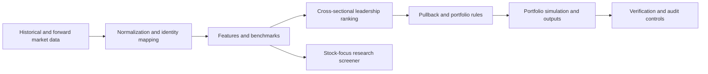

# Cross-Sectional Momentum Pullback

### Systematic equity research and portfolio backtesting

A Python-based quantitative research project combining cross-sectional equity momentum with pullback-based trade selection. The system brings together market-data preparation, security selection, portfolio simulation, and operational controls in a structured research workflow.

**This public project overview is intentionally documentation-only.** The strategy implementation, detailed parameters, data, credentials, and operational artifacts are maintained separately and are not distributed here.

## Research and engineering domains

- Historical equity data normalization and feature construction
- Cross-sectional leadership ranking and pullback screening
- Portfolio backtesting with position and exit controls
- Forward market-data preparation and security identity mapping
- Benchmark preparation and research diagnostics
- Production-state verification, recovery, and audit controls
- A separate stock-focus research screener

## Architecture

## Scope and disclosure

This is an independent quantitative research and software-engineering project. This overview does **not** present audited performance, offer an investment product, distribute executable strategy code, or recommend any security or trade. Backtests depend on data quality, assumptions, and execution modeling; past or simulated results do not guarantee future outcomes. Trading can result in substantial financial loss.

## Source availability

The project source and underlying datasets are not distributed through this public overview. **GitHub does not provide a way to prevent downloading or copying files contained in a public repository.** Nothing in this public package purports to impose a technical download restriction.

© 2026. All rights reserved by the original project author.

