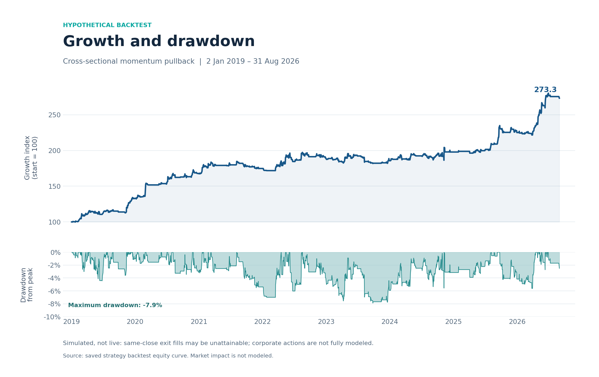
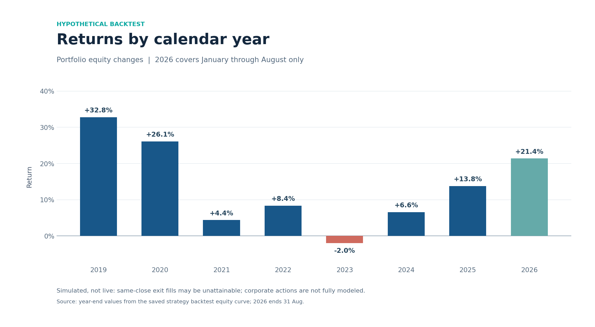
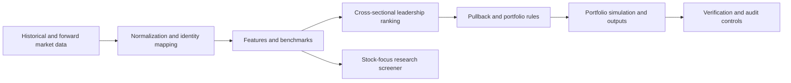

# Cross-Sectional Momentum Pullback

### Systematic equity research and portfolio backtesting

A Python-based quantitative research project combining cross-sectional equity momentum with pullback-based trade selection. The system brings together market-data preparation, security selection, portfolio simulation, and operational controls in a structured research workflow.

**This public project overview is intentionally documentation-only.** The strategy implementation, detailed parameters, data, credentials, and operational artifacts are maintained separately and are not distributed here.

## Historical backtest snapshot

**Preliminary simulation, not live or independently audited performance.** The model evaluates daily exit conditions using the closing price and assumes execution at that same close. That timing may not be achievable in practice. The engine does not explicitly credit dividends or adjust share quantities for splits, and historical and 2026 price-adjustment conventions differ. These limitations can materially distort returns and drawdowns.

The following figures summarize a saved strategy simulation from **January 2, 2019 through August 31, 2026**. The configuration was frozen after this period, so these results should not be interpreted as an independent out-of-sample test. The final year is partial.

| Measure | Simulated result |
| --- | ---: |
| Cumulative return | +173.25% |
| Annualized return (CAGR) | 14.02% |
| Maximum drawdown | -7.88% |
| Annualized volatility | 10.30% |
| Completed trades | 343 |
| Average gross exposure | 9.53% |

The equity curve begins at an index value of 100 and ends at 273.25. CAGR uses calendar elapsed time; volatility uses daily returns annualized with 252 sessions. The simulation assumes transaction costs of 0.05% per side, but does not establish actual fills or account for all real-world trading costs. Uninvested cash does not accrue explicit interest, and the portfolio held no positions on 52.23% of observed days. No benchmark is shown because the saved benchmark data and return conventions could not be independently aligned to the strategy series.

The charts and metrics were calculated from the saved daily equity curve and trade records. A stored state-verification check reports a discrepancy between two saved Sharpe-ratio values, so these results remain subject to further validation. There is no assurance that future or live results will resemble this simulation.

## Research and engineering domains

- Historical equity data normalization and feature construction
- Cross-sectional leadership ranking and pullback screening
- Portfolio backtesting with position and exit controls
- Forward market-data preparation and security identity mapping
- Benchmark preparation and research diagnostics
- Production-state verification, recovery, and audit controls
- A separate stock-focus research screener

## Architecture

## Scope and disclosure

This is an independent quantitative research and software-engineering project. This overview does **not** present audited performance, offer an investment product, distribute executable strategy code, or recommend any security or trade. Backtests depend on data quality, assumptions, and execution modeling; past or simulated results do not guarantee future outcomes. Trading can result in substantial financial loss.

## Source availability

The project source and underlying datasets are not distributed through this public overview. **GitHub does not provide a way to prevent downloading or copying files contained in a public repository.** Nothing in this public package purports to impose a technical download restriction.

© 2026. All rights reserved by the original project author.

